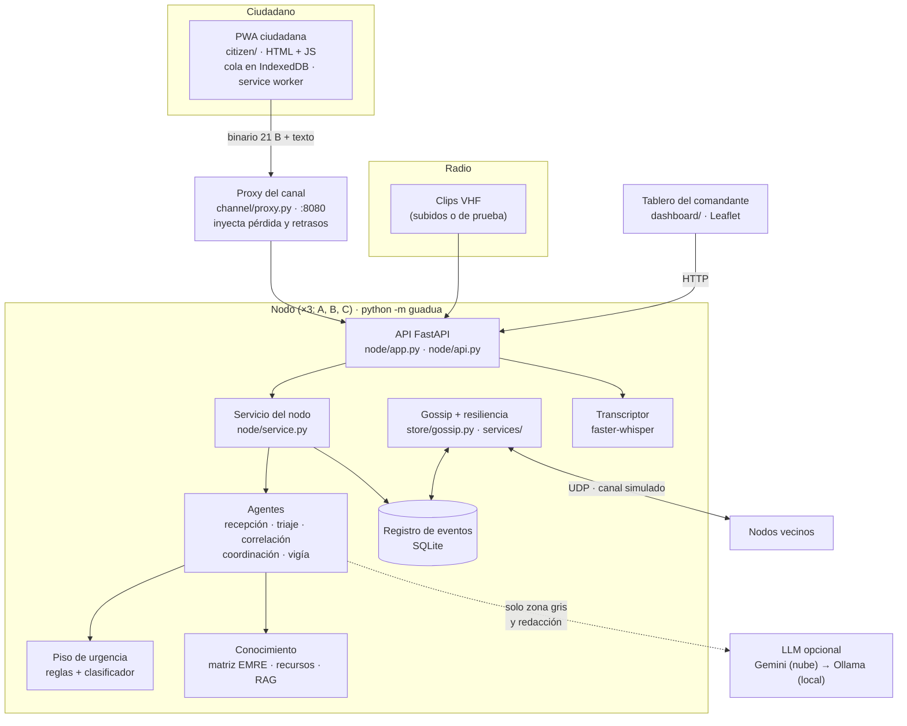
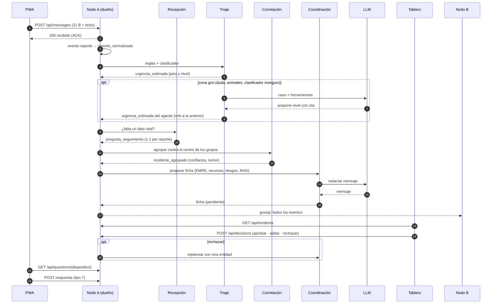

# Arquitectura · Guadua

Entregable 3. Componentes, distribución de agentes, flujos de mensajes, almacenamiento y dependencias **tal como están construidos**. Las razones de cada decisión están en [diseno.md](diseno.md); el protocolo, en [protocolo.md](protocolo.md); cada agente, en [fichas/](fichas/).

## 1. Componentes

| Componente | Dónde | Qué hace |
| :-- | :-- | :-- |
| PWA ciudadana | `citizen/` | Reporte en 3 toques, SOS de escombros con baliza acústica, "Estoy a salvo", preguntas de seguimiento. Arma el binario, lo guarda y lo reintenta sin conexión |
| Proxy del canal | `src/guadua/channel/` | En el prototipo, el tramo celular → nodo pasa por aquí para inyectar fallos con perfiles (Wi-Fi, LoRa, SMS) |
| API del nodo | `src/guadua/node/app.py`, `api.py` (contrato) | Recibe mensajes, sirve incidentes, decisiones, preguntas, personas, radio y las pantallas |
| Servicio del nodo | `src/guadua/node/service.py` | Guarda cada evento y dispara a los agentes; corre en otro hilo lo que usa LLM |
| Piso de urgencia | `src/guadua/classifier/` | Reglas (< 1 ms) + clasificador TF-IDF calibrado (< 2 ms); señales de riesgo y de lenguaje |
| Conocimiento | `src/guadua/knowledge/` | Matriz EMRE (quién responde), tabla de recursos y RAG híbrido (FTS5 + TF-IDF) sobre los PDF de la EMRE |
| Registro de eventos | `src/guadua/store/` | Eventos inmutables en SQLite; gossip entre nodos |
| Resiliencia | `src/guadua/services/` | Latidos, toma del trabajo de un nodo caído, cola de comunicación |
| Radio | `src/guadua/radio/` | Guarda el audio, lo transcribe con faster-whisper y lo separa en reportes |
| Tablero | `src/guadua/dashboard/` | Tarjetas por prioridad, aprobación humana, mapa, radio, personas a salvo y barra de simulación |

## 2. Distribución de agentes

Los tres nodos son iguales: cada uno ejecuta todos los agentes, pero **solo el nodo dueño** (el que recibió el reporte) crea sus eventos derivados. Los demás los reciben por gossip. No hay agente central: se coordinan a través del registro de eventos (pizarra).

| # | Agente | Tipo | Se dispara con | Publica | Ficha |
| :-- | :-- | :-- | :-- | :-- | :-- |
| 1 | Recepción | Reglas + LLM | `reporte_normalizado`, `transcripcion_radio` | `pregunta_seguimiento`, reportes de radio | [recepcion.md](fichas/recepcion.md) |
| 2 | Triaje | Reglas + clasificador + LLM en la zona gris | `reporte_normalizado`, `urgencia_estimada` ambigua | `urgencia_estimada` | [triaje.md](fichas/triaje.md) |
| 3 | Correlación | Determinista | `reporte_normalizado`, `confirmacion_campo` | `incidente_agrupado` | [correlacion.md](fichas/correlacion.md) |
| 4 | Comunicación | Servicio sin LLM | Mensajes por enviar y ACK | Tramas | [comunicacion.md](fichas/comunicacion.md) |
| 5 | Resiliencia | Servicio sin LLM | Latidos y registro | `reasignacion` | [resiliencia.md](fichas/resiliencia.md) |
| 6 | Coordinación | Determinista + LLM para redactar | `incidente_agrupado`, `decision` de rechazo | `ficha` | [coordinacion.md](fichas/coordinacion.md) |
| 7 | Vigía | Determinista (ronda periódica) | Reloj (cada 30 s) | `solicitud_vigia` | [vigia.md](fichas/vigia.md) |

**Con y sin LLM.** Todo funciona sin Internet ni API key: sin LLM, los casos dudosos quedan "ambiguo, revisar", las preguntas salen de reglas y las fichas de plantilla. Con LLM, la cadena es Gemini → Ollama → ninguno (`providers/fallback.py`); los agentes que lo usan corren en otro hilo para no frenar la recepción.

## 3. Flujo de un reporte

## 4. Almacenamiento

| Dónde | Qué | Tecnología |
| :-- | :-- | :-- |
| Celular | Cola de mensajes, dispositivo, consecutivo, último barrio, preguntas respondidas | IndexedDB (`guadua_citizen_db`) |
| Celular | Pantallas y datos para funcionar sin red | Service worker (caché `guadua-citizen-v8`) |
| Nodo | Registro de eventos inmutable (`events`: origen, consecutivo, categoría, tipo, hora de recepción, JSON) | SQLite (`SARD_DB`, volumen de Docker por nodo) |
| Nodo | Audio de los clips de radio (no viaja por gossip; la transcripción sí) | Archivos junto a la base |
| Nodo | Índice del RAG | SQLite en memoria (FTS5) + matriz TF-IDF, construidos al arrancar desde `data/emre_passages.json` |
| Repositorio | Matriz EMRE, recursos, riesgos por unidad, barrios, diccionario, corpus del RAG, PDF oficiales, datos sintéticos, clips | `data/` |
| Tablero | Operador y filtro elegido | `localStorage` |

Tipos de evento (catálogo en `store/event_types.py`): hechos (`reporte`, `a_salvo`, `transcripcion_radio`, `respuesta_seguimiento`, `confirmacion_campo`, `reasignacion`), derivados (`reporte_normalizado`, `urgencia_estimada`, `incidente_agrupado`, `ficha`, `pregunta_seguimiento`, `solicitud_vigia`) y decisiones humanas (`decision`).

## 5. Dependencias

| Capa | Dependencias | Para qué |
| :-- | :-- | :-- |
| Nodo (base) | Python 3.13, FastAPI, Uvicorn, Pydantic, msgpack, httpx | API, validación de eventos, gossip, clientes de LLM |
| Clasificador (`ml`) | scikit-learn, NumPy, SciPy | Clasificador de urgencia y búsqueda semántica del RAG |
| Agentes (`agents`) | LangGraph, langchain-core | Ciclo de herramientas del agente de triaje |
| Radio (`radio`) | faster-whisper (modelo `small`, CPU) | Transcripción de VHF |
| LLM (opcional) | Gemini por API o Ollama (`qwen2.5:7b`) | Zona gris, preguntas, separación de radio, redacción |
| PWA | JavaScript sin frameworks, pako (deflate) | Codificación binaria y compresión del texto |
| Tablero | JavaScript sin frameworks, Leaflet; OpenStreetMap solo con Internet | Tarjetas y mapa |
| Ejecución | Docker Compose: `node-a`, `node-b`, `node-c` (`:8000`–`:8002`) y `proxy` (`:8080`) | Tres nodos en red `A ↔ B ↔ C` |
| Herramientas | ruff, pytest, node --test, pre-commit; `pdftotext` solo para regenerar el corpus | Calidad y reproducibilidad |

Ninguna dependencia necesita Internet en ejecución: los modelos, el corpus y las librerías van en la imagen. Internet solo agrega Gemini y las calles del mapa.
