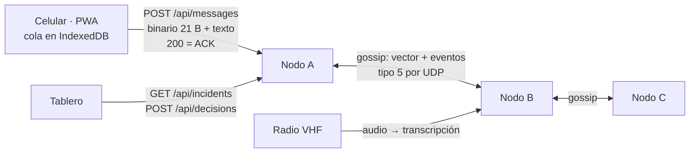

# Protocolo de comunicación · Guadua

Entregable 5. Esquema del mensaje, reintentos, confirmaciones, deduplicación y sincronización. Reúne lo que está definido en [contratos.md](contratos.md) y en el diseño (§5, §8 y §9) tal como está implementado. Las pruebas de compatibilidad entre Python y JavaScript usan los vectores de `tests/fixtures/`.

## 1. Tramos

- **Celular → nodo:** HTTP sobre el Wi-Fi del nodo, sin Internet. El `200` es la confirmación.
- **Nodo ↔ nodo:** UDP con el canal simulado (Wi-Fi, LoRa o SMS: trama, pérdida, retrasos y desorden). La red es incompleta a propósito: A y C solo se hablan a través de B.

## 2. Esquema del mensaje

### 2.1 Cabecera (21 B, big-endian)

| Bytes | Campo | Codificación |
| :-- | :-- | :-- |
| 0 | Versión + tipo | 4 bits altos: versión (1). 4 bits bajos: 0 reporte · 1 SOS escombros · 2 fragmento · 3 ACK · 4 "Estoy a salvo" · 5 lote de eventos · 6 pregunta · 7 respuesta · 8 fragmento de foto |
| 1–4 | Dispositivo | Entero de 32 bits, aleatorio por celular |
| 5–8 | Consecutivo | Entero de 32 bits, sube con cada mensaje del dispositivo |
| 9–12 | Hora del dispositivo | Segundos desde el 1 de enero de 2026 UTC. No se usa para ordenar |
| 13 | Incidente | 0 atrapados · 1 colapso · 2 incendio · 3 fuga de gas · 4 herido · 5 vía bloqueada · 6 otro |
| 14 | Personas | 0 una · 1 de 2 a 5 · 2 de 6 a 20 · 3 más de 20 · 4 no sé |
| 15 | Banderas | 0 atrapados · 1 no respira o sangrado · 2 incendio · 3 riesgo en escena · 4 niños o mayores · 5 observación directa · 6 GPS · 7 batería crítica |
| 16–20 | Ubicación | Con GPS: geohash de 7 caracteres (~150 m) en 35 bits + 5 en cero. Sin GPS: código de barrio (40 bits) |

El **ID del mensaje** es `dispositivo-consecutivo` (por ejemplo `007caa53-52`): 8 B en lugar de los 36 de un UUID. Se rechaza una cabecera con versión desconocida, menos de 21 B, valores fuera de las listas, GPS sin geohash (o al revés) o relleno distinto de cero.

### 2.2 Cuerpo según el tipo

| Tipo | Después de la cabecera |
| :-- | :-- |
| Reporte (0) | Texto opcional: 1 B de prefijo (versión del diccionario y modo: 0 UTF-8, 1 deflate con `data/diccionario_manizales.txt` como diccionario) y los datos; máximo 100 B |
| SOS escombros (1) | Nada: **21 B** |
| "Estoy a salvo" (4) | Nombre opcional, con el mismo formato del texto |
| Respuesta (7) | 1 B (0 No · 1 Sí · 2 No sé · `0x10+i` opción · `0x20` texto) y el `question_id` |
| Lote de eventos (5) | `0x15` y un mapa MessagePack (ver §6) |

Medido: el SOS ocupa 21 B; con texto, el promedio es 70,1 B y el máximo 116 B, así que todo cabe en un SMS. El diccionario de Manizales ahorra el 54,5 % frente a no comprimir.

### 2.3 Fragmentos y ACK

Un mensaje que no cabe en la trama del canal se parte:

| Bytes | Fragmento | ACK |
| :-- | :-- | :-- |
| 0 | Versión + tipo (2 o 8) | Versión + tipo (3) |
| 1–8 | ID del mensaje | ID del mensaje confirmado |
| 9 | Índice | Tipo confirmado |
| 10 | Total (1 a 255) | Total |
| 11… | Datos | Mapa de bits de lo recibido (⌈total/8⌉ B) |

Un mensaje que cabe en una trama se confirma con total 1 y mapa `01`.

## 3. Reintentos

| Dónde | Cuándo reintenta | Espera |
| :-- | :-- | :-- |
| Celular → nodo (`citizen/queue.js`) | Sin red, sin respuesta o con 5xx | 1 s, doblando hasta 30 s. El mensaje sigue en IndexedDB: sobrevive a cerrar la app |
| Nodo → canal (`services/queue.py`) | Sin ACK | 2 s, doblando hasta 16 s; mientras espera, la ventana es para el siguiente mensaje |
| Fragmentos | Lo que el ACK no marcó | Solo los fragmentos que faltan, no el mensaje entero |
| Gossip | No hay ACK | Cada ronda (2 s) el vector muestra los huecos y el vecino los vuelve a mandar |

**Prioridad al reintentar:** `peso + 3 × minutos en cola`, con pesos de 110 para control (SOS, "Estoy a salvo", ACK), 100/70/40/10 por urgencia y 5 para fotos. Lo crítico sale primero y lo bajo no espera para siempre: tras unos 20 minutos supera a un alto nuevo.

**Cuándo no reintenta:** un `400` del nodo significa que el mensaje no sirve (por ejemplo, un tipo no soportado): queda `rechazado` y el celular avisa. Un mensaje sin ACK por 2 h no se borra: pasa a `por_confirmar`.

## 4. Confirmaciones

- **Celular → nodo:** `200` con `MessageAck` (`report_id`, `status: "recibido"`, `duplicate`). La PWA muestra Guardado → Enviando → Recibido.
- **Nodo ↔ nodo:** ACK con mapa de bits por mensaje; el emisor sabe exactamente qué fragmentos llegaron.
- **Respuestas de seguimiento:** vale la primera; la segunda recibe `200` con `duplicate: true`.
- **Gossip:** sin ACK; la confirmación es implícita en el siguiente vector del vecino.

## 5. Deduplicación

| Qué | Cómo se reconoce |
| :-- | :-- |
| El mismo reporte reenviado (el celular no recibió el ACK) | Mismo `dispositivo-consecutivo`: `200` con `duplicate: true` y no se guarda |
| El mismo "Estoy a salvo" | Igual, por su ID |
| Un fragmento repetido | Mismo ID e índice: no se guarda dos veces |
| Un evento recibido por gossip dos veces | Mismo ID de evento (`nodo:seq`): el registro lo ignora |
| La misma respuesta a una pregunta | La primera vale; las demás son duplicadas |
| El mismo hecho contado por varias personas | No es deduplicación sino **correlación**: se agrupan en un incidente con confianza (ver la ficha de correlación) |

## 6. Sincronización entre nodos

Cada nodo guarda un **registro de eventos inmutable** en SQLite (solo se agregan; nunca se editan ni se borran). Un evento se identifica por su nodo de origen y su consecutivo (`A:52`).

1. **Vector.** En cada ronda, cada nodo envía `{"k": "v", "vv": {"A": 12, "B": 8}, "d": <8 B>}`: por origen, el último consecutivo sin huecos, y un resumen (`digest`) de todo su registro. Si el resumen coincide, no se envía nada más.
2. **Eventos.** Si al vecino le falta algo, recibe `{"k": "e", "ev": {...}}` por cada evento faltante. Si no cabe en la trama, se fragmenta; el ID del fragmento sale del ID del evento, así que un reenvío en otra ronda completa lo que faltaba.
3. **Validación.** Todo evento recibido se valida contra el catálogo antes de guardarlo; lo inválido se descarta y se cuenta.
4. **Convergencia.** Como los eventos son inmutables y se identifican igual en todos lados, dos nodos con los mismos eventos tienen el mismo `digest`. Medido: hashes iguales en 36 de 36 escenarios del banco de fallos, también con 60 % de pérdida, particiones y caídas.
5. **Un solo dueño.** Solo el nodo que recibió un reporte crea sus eventos derivados (urgencia, grupo, ficha); los demás los reciben por gossip. Si el dueño cae, un vecino publica una `reasignacion` y termina su trabajo (ficha de resiliencia).
6. **Conflictos.** Si una partición hace que dos nodos concluyan cosas distintas sobre el mismo caso, se conserva la urgencia más alta y las dos conclusiones quedan en "por qué está aquí"; una urgencia que referencia a otra (la del agente sobre la de las reglas) la reemplaza, nunca por debajo del piso.
